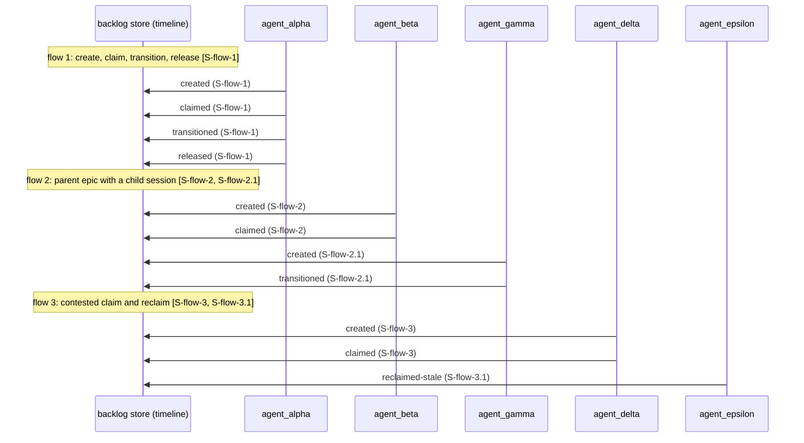

# Agent process flows, reconstructed from `timeline`

Generated, not hand-written, by driving three real agent flows through the BUILT `adhd-backlog` bin with `sessionId` set
(driver: `entrypoint/backlog/src/test/helpers/session-flows-driver.ts`; projection: `session-flows-evidence.ts`),
then reading `timeline` for each session (91a8c640, B-AC8).

**Store:** an isolated sandbox store minted per run by `mintBacklogSandbox` (`--namespace sandbox`, a fresh `ADHD_ROOT` under the OS
temp dir, embeddings off). It is never the production store. The sandbox is discarded after each run, so the evidence block below is
re-derived from a fresh drive and compared byte-for-byte by `entrypoint/backlog/src/session-flows-doc.e2e.ts`; a stale or edited
session id fails that test. No production session existed that exercised `sessionId`, so these 5 driven sessions (`S-flow-1`, `S-flow-2`, `S-flow-2.1`, `S-flow-3`, `S-flow-3.1`) are the real sessions of this build.

## Flows

- **flow 1: create, claim, transition, release** cites session `S-flow-1`.
- **flow 2: parent epic with a child session** cites sessions `S-flow-2`, `S-flow-2.1`.
- **flow 3: contested claim and reclaim** cites sessions `S-flow-3`, `S-flow-3.1`.



## Evidence

```json
[
  {
    "name": "flow 1: create, claim, transition, release",
    "sessionId": "S-flow-1",
    "agent": "agent-alpha",
    "parentSessionId": null,
    "children": [],
    "ops": [
      {
        "sessionId": "S-flow-1",
        "agent": "agent-alpha",
        "op": "created"
      },
      {
        "sessionId": "S-flow-1",
        "agent": "agent-alpha",
        "op": "claimed"
      },
      {
        "sessionId": "S-flow-1",
        "agent": "agent-alpha",
        "op": "transitioned"
      },
      {
        "sessionId": "S-flow-1",
        "agent": "agent-alpha",
        "op": "released"
      }
    ]
  },
  {
    "name": "flow 2: parent epic with a child session",
    "sessionId": "S-flow-2",
    "agent": "agent-beta",
    "parentSessionId": null,
    "children": [
      "S-flow-2.1"
    ],
    "ops": [
      {
        "sessionId": "S-flow-2",
        "agent": "agent-beta",
        "op": "created"
      },
      {
        "sessionId": "S-flow-2",
        "agent": "agent-beta",
        "op": "claimed"
      },
      {
        "sessionId": "S-flow-2.1",
        "agent": "agent-gamma",
        "op": "created"
      },
      {
        "sessionId": "S-flow-2.1",
        "agent": "agent-gamma",
        "op": "transitioned"
      }
    ]
  },
  {
    "name": "flow 3: contested claim and reclaim",
    "sessionId": "S-flow-3",
    "agent": "agent-delta",
    "parentSessionId": null,
    "children": [
      "S-flow-3.1"
    ],
    "ops": [
      {
        "sessionId": "S-flow-3",
        "agent": "agent-delta",
        "op": "created"
      },
      {
        "sessionId": "S-flow-3",
        "agent": "agent-delta",
        "op": "claimed"
      },
      {
        "sessionId": "S-flow-3.1",
        "agent": "agent-epsilon",
        "op": "reclaimed-stale"
      }
    ]
  }
]
```
